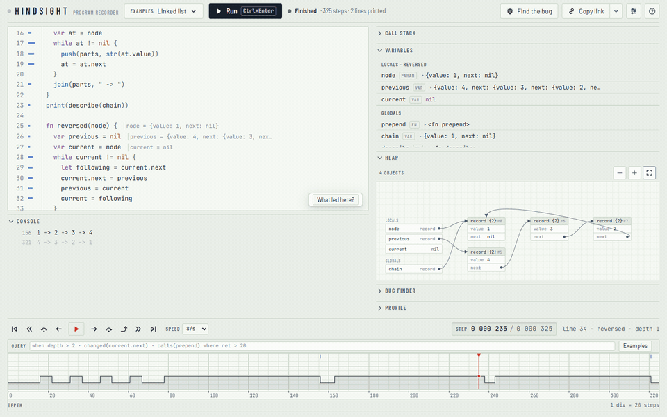
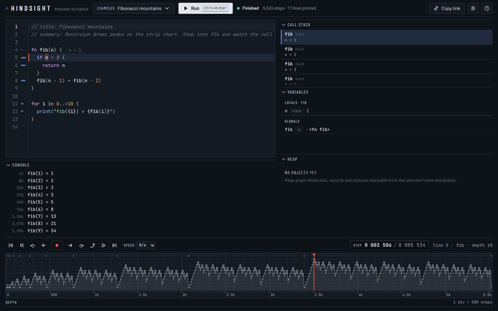
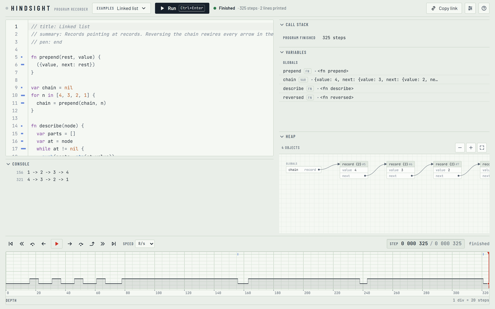
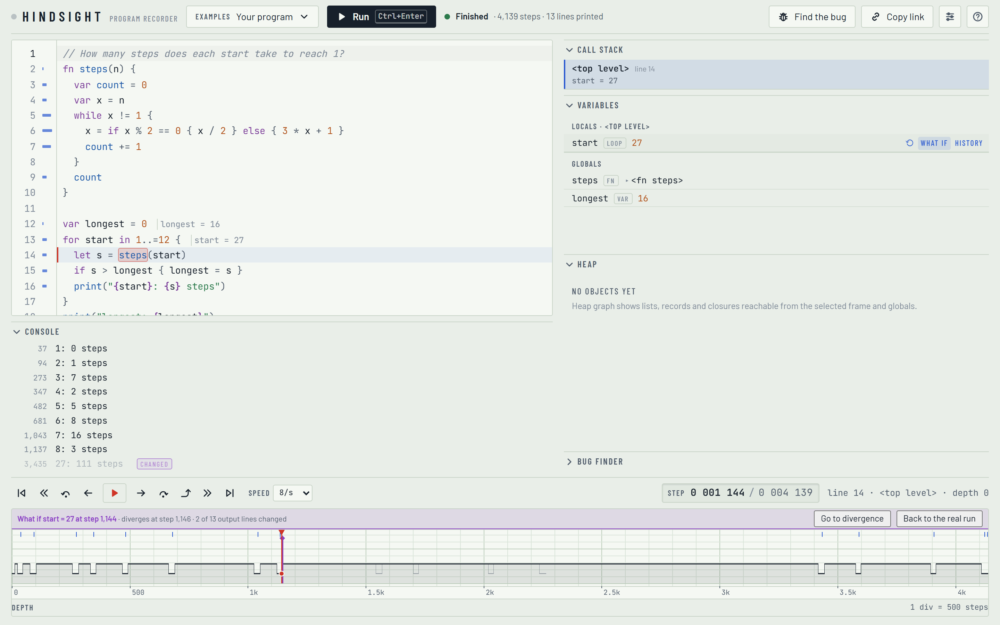
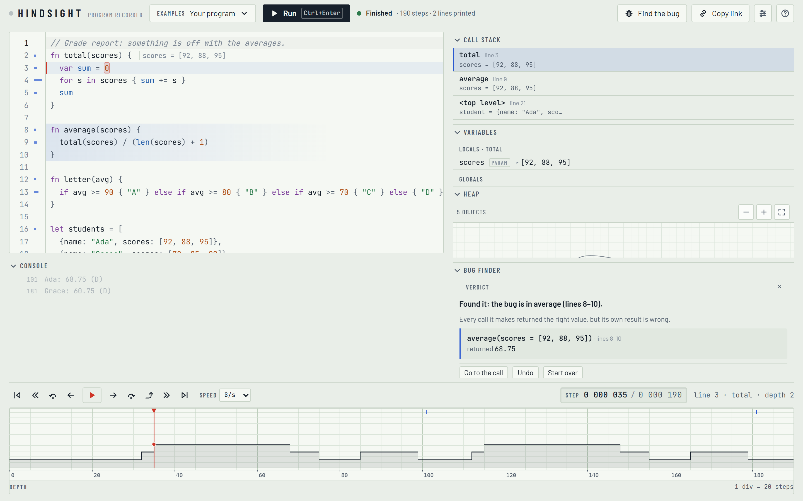

# Hindsight

[](https://github.com/Ajaypranav25/Hindsight/actions/workflows/ci.yml)
[](https://www.npmjs.com/package/hindsight-lang)

**A tiny programming language with a time machine built in.**



Run a program, then drag a red pen backwards through its execution. Step into, over and out of
calls in _both_ directions, ask any variable where its value came from, click a line of output to
land on the moment it was printed, and watch the heap rewire itself as you scrub.

Then change the past: give any variable another value at any moment and Hindsight forks the run
there, so you see where the new future diverges from the real one. Or let it find the bug: answer
a few yes/no questions about the calls your program made, and it names the function whose own code
is wrong.

Hindsight is a language and a debugger designed together. Every program runs on a bytecode VM that
records its own execution, so the studio can rebuild the complete program state at any step — the
call stack, every variable, every list and record — in under a millisecond.

## Try it

**The desktop app** for Windows, macOS and Linux: download it from the
[latest release](https://github.com/Ajaypranav25/Hindsight/releases/latest).

- Windows: `Hindsight-Setup-x64.exe` (installs for your user only, no administrator needed)
- macOS on Apple silicon: `Hindsight-mac-arm64.dmg` (or `Hindsight-mac-arm64.zip`)
- macOS on Intel: `Hindsight-mac-x64.dmg` (or `Hindsight-mac-x64.zip`)
- Linux: `Hindsight-linux-amd64.deb` for Debian and Ubuntu (the better choice there), or
  `Hindsight-linux-x86_64.AppImage` for any distribution

`SHA256SUMS.txt` beside them lists each file's checksum. The app is not signed yet, so the first
launch needs one extra step:

- **Windows** SmartScreen says it protected your PC: click **More info**, then **Run anyway**.
- **macOS** says it cannot check the app: open **System Settings > Privacy & Security** and click
  **Open Anyway** beside the message about Hindsight.
- **Linux**: install the `.deb` with `sudo apt install ./Hindsight-linux-amd64.deb`. It brings an
  AppArmor profile, so the app keeps Chromium's sandbox on Ubuntu 24.04, and it registers the
  `.sight` files and `hindsight://` links. The AppImage needs to be made executable
  (`chmod +x Hindsight-linux-x86_64.AppImage`) and needs FUSE 2, which Ubuntu 22.04 and later
  leave out: `sudo apt install libfuse2` (on 24.04, `sudo apt install libfuse2t64`), or run it
  with `--appimage-extract-and-run`. Where AppArmor blocks unprivileged user namespaces (Ubuntu
  24.04), the AppImage starts without Chromium's sandbox.

**From a checkout**, run the studio in your browser:

```sh
npm install
npm run dev          # opens Hindsight Studio at http://localhost:5173
```

The studio opens with a gallery program already recorded. Pick another from **Examples**: a bug hunt
where the answer is one click away, a crash you can rewind out of, recursion that draws mountain
ranges, closures, a breadth-first maze search, the Game of Life, a bug to find by answering
questions, a what-if to fork, contracts that let the bug finder answer its own questions, and more.

## A taste of the language

```
fn fib(n) {
  if n < 2 { n } else { fib(n - 1) + fib(n - 2) }
}

let orders = [
  {customer: "ada", amount: 30, paid: true},
  {customer: "grace", amount: 12, paid: false},
  {customer: "ada", amount: 55, paid: true},
]

let revenue = orders
  |> filter(|o| o.paid)
  |> map(|o| o.amount)
  |> sum()

match [fib(10), revenue] {
  [55, total] if total > 80 => print("all good: {total}")
  [f, _] => print("unexpected fib: {f}")
}
```

Dynamically typed and expression-oriented: blocks, `if` and `match` produce values; `let` bindings
are immutable and `var` ones are not; functions are closures; lists, records and ranges are built in;
pattern matching destructures lists and records with guards and alternatives; `|>` pipes values
through calls; strings interpolate `{expressions}`. Error messages are specific and come with hints
(`undefined variable 'lenght'` → `did you mean 'length'?`). The full reference is
[docs/SPEC.md](docs/SPEC.md).

Functions can state what they need and what they promise. Contracts are checked on every call:

```
fn average(xs)
  requires len(xs) > 0                  // checked at entry: a failure blames the caller
  ensures result == sum(xs) / len(xs)   // checked at every return, with result bound
{
  sum(xs) / len(xs)
}
```

A broken `requires` is `R026 precondition failed: len(xs) > 0` with the arguments in the hint; a
broken `ensures` is `R027 postcondition failed: …` with the returned value. `requires`, `ensures`
and `result` stay ordinary names everywhere else.

Tasks and channels make concurrency something you can rewind. `spawn` starts a task, channels pass
values between tasks (unbuffered ones are a rendezvous), `wait` joins a task and `yield` lets
another run:

```
let jobs = channel(2)
fn worker() {
  var job = recv(jobs)
  while job != nil {           // recv returns nil once the channel is closed and empty
    print(job * job)
    job = recv(jobs)
  }
}
let w = spawn(worker)
for i in 1..=3 { send(jobs, i) }
close(jobs)
wait(w)
```

Tasks are cooperative and deterministic: one instruction at a time on one machine, switching only
when a task blocks, yields or ends. The default round-robin schedule is fully predictable; a
**random** schedule (a seed and a quantum, chosen by the tool, never by `random()`) also preempts,
so races show up, and the same seed always gives the same interleaving. When every task is
waiting, the run stops with `R028 deadlock: every task is waiting` and a hint that says what each
task waits for. See [SPEC §10.6](docs/SPEC.md).

## The studio



|                                 |                                                                                                                                                                                                                                                                                                                                                                                                             |
| ------------------------------- | ----------------------------------------------------------------------------------------------------------------------------------------------------------------------------------------------------------------------------------------------------------------------------------------------------------------------------------------------------------------------------------------------------------- |
| **Strip chart**                 | The whole run is traced like a chart recorder: x is time, height is call depth. Drag the pen anywhere; zoom and pan with the wheel. Output, breakpoint hits and watched writes appear as markers.                                                                                                                                                                                                           |
| **Two-way stepping**            | Step into, over and out, forwards and backwards. Continue to a breakpoint, or back to the previous one. Step over is based on the actual call, not just the depth, so `sq(2) + sq(3)` behaves.                                                                                                                                                                                                              |
| **⟲ Where did this come from?** | Every variable, list element and record field has an origin button. It jumps to the step that produced the value and marks the line that set it.                                                                                                                                                                                                                                                            |
| **History**                     | Every change to a binding, as a list and a sparkline, plotted on the strip chart. Loop variables keep one history across iterations.                                                                                                                                                                                                                                                                        |
| **Time-aware console**          | Output printed after the pen is ghosted. Click any line to land on the moment it was printed.                                                                                                                                                                                                                                                                                                               |
| **Heat gutter**                 | How often each line ran, on a log scale. Click to jump to the next time it runs.                                                                                                                                                                                                                                                                                                                            |
| **Heap graph**                  | Lists, records and closures reachable from the selected frame, with stable positions as you scrub, so a reversed linked list visibly rewires its arrows.                                                                                                                                                                                                                                                    |
| **Just my code**                | Library functions (`map`, `filter`, `sort_by`, …) are written in Hindsight and recorded too; just-my-code skips them unless you want to look inside.                                                                                                                                                                                                                                                        |
| **What if?**                    | Change any variable, list element or record field at the pen: the run forks there, the strip chart shows where the new future diverges (with the real run as a ghost behind it), and changed output is marked. Fork again to stack edits.                                                                                                                                                                   |
| **Bug finder**                  | Answer right / wrong / not sure about recorded calls (`average(xs = [88, 83, 79])` returned `54`) until Hindsight names the function whose own code is wrong. Identical calls are asked about only once.                                                                                                                                                                                                    |
| **Self-answering bug finder**   | Contracts and assertions answer the questions they can, each with its reason (`right: the assertion on line 13`, `wrong: its postcondition on line 29 failed`); Undo takes one back. With enough of them the verdict needs no questions.                                                                                                                                                                    |
| **Moment links**                | Copy a link that carries the program and the pen's step: it opens on the very moment you were looking at, so a bug report lands on the bug.                                                                                                                                                                                                                                                                 |
| **Query bar**                   | Type `changed(order.paid)`, `calls(fib) where ret > 20` or `when depth > 2` above the strip chart and every match lights up on the timeline; Previous / Next / List walk through them. Examples offers one query per form, written with your program's names.                                                                                                                                               |
| **Lines that led here**         | After a crash the lines that had no part in it are dimmed. "What led here?" (the pen's step) and "What led to this?" (any console line) do the same for any moment: a causal bar marks every line in the backward slice, an arrowhead the line where the traced step ran, the strip chart shades the slice's steps, and a chip lists the causal chain (`total = 72 · step 410 · line 8`), each link a jump. |
| **Why didn't this run?**        | Click the hollow heat mark of a line that never ran (or press Shift+F9): an explanation opens right under the line in the editor — "`if total > 80` was false at step 412 because `total` was 72, set at step 410" — with Go to the decision / Go to where it was set, and a badge on the guard's line.                                                                                                     |
| **Make it so**                  | Ask a console line to print something else ("Make this print…") or a crash not to happen: Hindsight searches the past for one earlier value that does it and offers "Try it", which forks the run with that value. "Try one-token fixes" previews small repairs that make a crashing run finish.                                                                                                            |
| **Console line menu**           | Right-click a console line (or press Shift+F10 or the ContextMenu key on it) for Make this print…, What led to this?, Go to this moment and Copy line.                                                                                                                                                                                                                                                      |
| **Sweeps**                      | Type `1..20` instead of one value in a what-if: the run forks once per value, every run is drawn as a ghost trace on the strip chart and listed with its steps, depth, outcome and output change; a row opens that run.                                                                                                                                                                                     |
| **Heap ghost edges**            | During a what-if the heap graph draws the references only the what-if has solid and the ones only the real run has dashed.                                                                                                                                                                                                                                                                                  |
| **Since your edit**             | After each edit the new run is compared with the one before it, call by call: a strip says how the output changed, where the change starts and how many calls behave differently; Show lists them (old result → new result), each a jump into the new run.                                                                                                                                                  |
| **Keep my place**               | After an edit the pen goes to the same moment of the new run (the same call, the same time round its loop), not just the same step number. A setting turns it off.                                                                                                                                                                                                                                          |
| **Profile**                     | Where the run spent its steps: a flame chart (hover for steps, calls and share; click to land on the first call of that path) and a table of functions and lines.                                                                                                                                                                                                                                           |
| **Suggest contracts**           | With the cursor on a `fn` line (or from the call stack), Hindsight proposes `requires`/`ensures` clauses that held in every recorded call and checks them by recording the program with them; "Add to the function" writes the ones you keep into its header.                                                                                                                                               |
| **Swim lanes**                  | A program with tasks gets one lane per task on the strip chart, each in its own color with its call depth, and hatched stretches where the task was waiting on a channel or another task. The call stack lists every task with what it is doing or waiting for.                                                                                                                                             |
| **Schedules and deadlocks**     | Settings > Task schedule switches between round-robin and a random schedule with a seed; Next seed records the program again under another interleaving, so a lost update can be caught in the act and rewound. A deadlock is explained in the console: one line per task, saying what it waits for and where.                                                                                              |
| **Off the main thread**         | Slices, queries, the Make-it-so search, repair previews and sweeps run in a Web Worker, which records the same run again from its description (program, seed, step limit, what-if edits) and sends back plain results; without workers they run on the page in small slices.                                                                                                                                |







Keyboard: **F11** / **Shift+F11** step into forward/back, **F10** / **Shift+F10** step over,
**F7** / **Shift+F7** step out, **F8** / **Shift+F8** continue, **F9** breakpoint, **Space** play,
**Home** / **End** jump to the ends, **Ctrl+Enter** run, **Shift+F9** why didn't the cursor line run.
On a console line, **Shift+F10** opens its menu instead of stepping back over.

## Desktop app

The desktop app is the studio in a window of its own, with what a browser tab cannot do:

- **Files.** **File > Open**, **Save** and **Save As** read and write `.sight` programs. The title
  bar shows the file's name and whether it has unsaved changes; closing the window, or opening
  something else over a file with unsaved changes, asks whether to save them first. A save
  replaces the file in one step, so a full disk never leaves it half-written. **File > New**
  starts an empty program. As with links and examples, the program a file or a new program
  replaces is kept, and **Restore** brings it back.
- **Double-click** a `.sight` file to open it, or a `.sighttrace` file to open the run it holds.
  On Linux this comes with the `.deb`; an AppImage needs a desktop-integration tool such as
  AppImageLauncher for it.
- **`hindsight://` links.** In the app, **Copy link** copies a `hindsight://open/#src=…` link that
  opens the program, at the pen's step, in the app on any machine that has it (on Linux, one where
  the `.deb` is installed, or an AppImage integrated as above). Links hold up to 30,000
  characters; save longer programs as files. **Hindsight: Open in Studio** in the VS Code
  extension opens programs in the app the same way.
- **Offline.** The studio and its fonts ship inside the app.

To build it from a checkout (the app serves the built studio, so build that first):

```sh
npm install && npm run build:studio
cd desktop && npm ci
npm run build        # builds the app
npm start            # runs the app from the build
npm run pack         # an unpacked app in desktop/release/ (what the end-to-end tests drive)
npm run dist         # the installers, in desktop/release/
npm run e2e          # Playwright drives the built app
```

Details: [desktop/README.md](desktop/README.md).

## The command line

Install the `hindsight` command from npm (Node 22.12 or later; the package has no dependencies), or
run it without installing through `npx`:

```sh
npm i -g hindsight-lang
hindsight run examples/03-fibonacci.sight
npx hindsight-lang run examples/03-fibonacci.sight   # the same, without a global install
```

From a checkout, run it through npm as below, or build it once with `npm run build:cli && npm link`.

```sh
npm run sight -- run examples/03-fibonacci.sight
npm run sight -- replay examples/03-fibonacci.sight --at 3500     # the program state at step 3,500
npm run sight -- why examples/02-bug-hunt.sight --line 8 --name total   # every change to 'total'
npm run sight -- disasm examples/01-hello.sight
npm run sight -- test                                            # the conformance corpus
npm run sight -- repl
npm run sight -- whatif examples/18-what-if.sight --at 1144 --set start=27   # fork the run
npm run sight -- debug examples/17-find-the-bug.sight                       # find the bug
npm run sight -- debug examples/19-contracts.sight --no-ask   # contracts answer every question
npm run sight -- solve examples/18-what-if.sight --want "longest: 111"      # what past prints this?
npm run sight -- query examples/18-what-if.sight 'calls(steps) where ret > 15'
npm run sight -- whynot FILE --line 12        # why did line 12 never run?
npm run sight -- slice FILE                   # which lines led to the crash (or the last output)?
npm run sight -- repair FILE                  # one-token fixes for a crash
npm run sight -- diff OLD NEW                 # where do two versions start to behave differently?
npm run sight -- diff FILE --set n=10         # the same program with another input
npm run sight -- profile FILE --lines         # where did the run spend its steps?
npm run sight -- infer FILE                   # requires/ensures clauses that held in every call
npm run sight -- races examples/21-bank-race.sight   # try 20 random schedules, name the race
npm run sight -- run FILE --schedule random --schedule-seed 3   # one interleaving, reproducibly
npm run sight -- mcp                          # the debugger as an MCP server for AI agents
```

`whatif` forks the recorded run and compares the two futures:

```
what if start = 27 at step 1,144 (it was 9)
the futures diverge at step 1,146 · line 16, column 11 · in <top level>
real run: 2,264 steps, finishes normally
what if:  4,139 steps, finishes normally
output: 2 lines only in the real run (-), 2 only in the what-if (+)
 … 5 unchanged lines
 8: 3 steps
-9: 19 steps
+27: 111 steps
 10: 6 steps
 …
-longest: 19
+longest: 111
```

`debug` interviews you about the calls the program made, then points at the culprit:

```
Question 1: average(scores = [92, 88, 95]) returned 68.75
Is that right? [r/w/n/u/q] w
Question 2: total(scores = [92, 88, 95]) returned 275
Is that right? [r/w/n/u/q] r
Found it: the bug is in average (lines 10–12).
Every call it makes returned the right value, but its own result is wrong.

  10 | fn average(scores) {
  11 |   total(scores) / (len(scores) + 1)
  12 | }
```

`debug` asks by halving the calls under suspicion (`--strategy top-down` asks in call order), shows
what a call changed outside itself, and ends with one-token repairs that agree with your answers.

Contracts and assertions answer what they can on their own, so `examples/19-contracts.sight` needs
no questions at all:

```
Question 1: total(items = [...], percent = 10) raised an error: postcondition failed: … — wrong (its postcondition on line 29 failed)
Question 2: subtotal(items = [...]) returned 55 — right (an identical call passed the assertion on line 38)
Question 3: discount(amount = 55, percent = 10) returned 5.5 — right (its postcondition on line 15 held)
Question 4: shipping(amount = 55) returned 0 — right (an identical call passed the assertion on line 39)
Found it: the bug is in total (lines 27–33).
✓ line 32: `+` → `-`
```

A failed `ensures` blames its function, a failed `requires` its caller; an `ensures result == …`
vouches for every call that returned; `assert(f(args) == expected)` judges every call of `f` with
those arguments (unless `expected` or the arguments call `f` again). Neither vouches for a call that
changed something outside itself. `--no-auto` asks you everything; `--no-ask` never asks: it stops at the first
question nothing can answer and exits with code 3, so scripts and agents can tell.

The interview also learns from you: after the verdict, every call you judged right is printed as an
assertion (`assert(total([92, 88, 95]) == 275)`) when it means the same anywhere in the program (no
global variables, printing or random numbers involved). Add them to the program (the studio has a button
for it) and the next interview answers those questions itself.

`solve` runs a what-if backwards, and `query` finds moments by condition (`when x > 3 and depth > 1`,
`changed(order.paid)`, `calls(f) where ret < 0`):

```
goal: output line 13 to read "longest: 111" (it reads "longest: 19")
✓ If count at step 1,149 had been 92 instead of 0, line 20 would have printed longest: 111.  (line 5)
tried 5 earlier values in 11 what-if runs

2 calls
  step 691       steps(n = 7) returned 16
  step 1,147     steps(n = 9) returned 19
```

`whatif --set start=1..20` sweeps a range and prints one row per value.

`diff` runs two versions of a program (or one program with a top-level `let` given another value)
and compares what they did, call by call: calls are aligned by call tree, so inserted, removed and
renamed calls are found, and the **origin** is the call that, given the same inputs, behaved
differently while the calls it made did not — where the change starts. Exit codes follow diff(1):
0 same behavior, 1 different, 2 trouble.

```
diff A = average.sight, B = fixed.sight
A: 60 steps, finishes normally, 3 calls
B: 58 steps, finishes normally, 3 calls
output: 1 line only in A (-), 1 only in B (+)
-68.75
+91.66666666666667
changed calls (2):
  the top-level code · output
  average · result
    - average(scores = [92, 88, 95]) returned 68.75  step 13
    + average(scores = [92, 88, 95]) returned 91.66666666666667  step 13
the change starts in:
  ✓ average (lines 6–8): given the same inputs, it behaves differently while the calls it makes behave the same
```

`profile` counts steps (one step is one instruction, so the numbers are exact and repeatable), with
library code folded into the user calls that made it; `--folded` prints folded stacks for flame
graph tools:

```
5,534 steps · 2 functions · library code folded into its callers

inclusive    share  exclusive  calls  avg/call  max/call  function
    5,534  100.0 %        164      1     5,534     5,534  <top level>
    5,370   97.0 %      5,370    453        63     2,118  fib (line 4)

steps    share  line
2,431   43.9 %     8 | fib(n - 1) + fib(n - 2)
2,254   40.7 %     5 | if n < 2 {
```

`infer` suggests contracts the way Daikon finds likely invariants: for every `fn` called with at
least three different inputs, clause templates (types, signs, order and length relations,
membership, sortedness, `result == a * x + b`, …) are kept when they held in every call, and the
survivors are checked by recording the program again with them written in. `--write` adds them to
the function headers.

```
quicksort (line 4) · 15 calls, 8 different inputs
  ensures  result == sort(xs)   8 inputs · e.g. quicksort(xs = [33, 4, 15, 8, 42, 16, 23]) returned [4, 8, 15, 16, 23, 33, 42]
  requires type(xs) == "list"   8 inputs · e.g. quicksort(xs = [33, 4, 15, 8, 42, 16, 23]) returned [4, 8, 15, 16, 23, 33, 42]

checked: the program runs the same with these 2 clauses written in
```

The clauses say what the program did, not what it should do. That is the point: infer them on a
version you trust and add them, and when a later change breaks something, `debug` (and the studio's
bug finder) answers its own questions from them, an `ensures result == …` vouching for every call
it covers.
`races` records a program with tasks under many random schedules (`--runs`, `--seed`, `--quantum`),
lists the different results, and explains the first two: where the schedules diverge, the shared
places more than one task wrote before the output differed (the race candidates), and the calls
where the difference starts. It exits 1 when the results differ.

```
20 schedules (random, quantum 10): 19 different results
   2 runs  printed "alice 90, bob 110, total 200"  seeds 1, 9
   1 run   printed "alice 150, bob 90, total 240"  seed 2
   …
race candidates (written by more than one task before that):
  accounts.bob  task 2 (teller) 5×, task 3 (teller) 5× · lines 10, 11
  accounts.alice  task 2 (teller) 5×, task 3 (teller) 5× · lines 10, 11
```

`run`, `replay` and `record` take `--schedule random [--schedule-seed S] [--quantum Q]`; trace files
keep the schedule.

### Trace files

A moment link stops working once a program passes 60,000 characters. A `.sighttrace` file holds the
same moment for any size: the program, its seed and step limit, the what-if edits and the pen, plus
a fingerprint of the run. It is small because it never stores the trace: the VM is deterministic,
so opening the file records the run again and checks the fingerprint. If another Hindsight version
replays it differently, you are told where the runs first differ.

```sh
hindsight record examples/02-bug-hunt.sight          # writes examples/02-bug-hunt.sighttrace
hindsight replay examples/02-bug-hunt.sighttrace     # the state at the saved step
hindsight slice examples/02-bug-hunt.sighttrace      # run, replay, why, whynot, slice, query accept one
```

In the studio, the button next to **Copy link** downloads the run on display as a trace (what-if
edits included) and opens one; you can also drop a `.sighttrace` file on the editor. The pen lands
on the saved step with the what-if edits applied again.

### MCP server

`hindsight mcp` speaks the Model Context Protocol over stdio, so an AI agent can stop guessing
what a `.sight` program does and ask the recording instead: run it, look at any step, ask where a
value came from, fork a what-if, find the bug and check its fix:

```json
{ "mcpServers": { "hindsight": { "command": "npx", "args": ["-y", "hindsight-lang", "mcp"] } } }
```

With a global install (`npm i -g hindsight-lang`), `"command": "hindsight", "args": ["mcp"]` does the
same. From a checkout without a linked build, use `"command": "npx", "args": ["tsx", "src/cli/main.ts",
"mcp"]` with the repository as the working directory.

| tool                                      | for                                                                                                                                                                                                                                      |
| ----------------------------------------- | ---------------------------------------------------------------------------------------------------------------------------------------------------------------------------------------------------------------------------------------- |
| `run_trace`                               | record a program: a trace id, the outcome, the output (in pages)                                                                                                                                                                         |
| `diagnose_failure`                        | a crash or a wrong output line in one call: error, stack, the values the failing statement reads, the slice, the causal chain and verified one-token repairs                                                                             |
| `find_bug`                                | a stateless interview about calls that ends at the function whose own code is wrong, with repair previews; expected results answer questions by themselves                                                                               |
| `suggest_repairs`                         | one-token patches checked against a crash or against expectations like `{"call": "average([92, 88, 95])", "expected": "91.66666666666667"}`                                                                                              |
| `diff_runs`                               | two versions (or two inputs) compared call by call: where the difference starts, and which expectations a fix meets                                                                                                                      |
| `verify_patch`                            | a fix the agent wrote, run and judged: compile errors, crash fixed or not, expectations in both runs, contract failures, what changed call by call, and a verdict (fixed, improved, unchanged, regressed, does-not-compile) with reasons |
| `seek_state`, `query_provenance`, `query` | the state at a step (with depth, item and frame budgets), where a value came from, moments by condition (in pages, or summarized)                                                                                                        |
| `fork_whatif`, `get_divergence`, `solve`  | counterfactuals forwards and backwards                                                                                                                                                                                                   |
| `why_not`, `slice`                        | why a line never ran; which lines can have caused a moment                                                                                                                                                                               |
| `profile`, `infer_contracts`              | where a run spent its steps (functions, lines, folded stacks); likely `requires`/`ensures` clauses, checked by a re-run, to add to a trusted version                                                                                     |
| `explore_schedules`                       | the race finder for programs with tasks: distinct results under random schedules, each kept as a trace, with the race candidates; `run_trace` takes a `schedule`                                                                         |
| `export_trace`, `open_trace`              | a recorded run as a small `.sighttrace` file (base64) to attach to an issue, and back                                                                                                                                                    |

Results are sized for a context window: long lists come in pages that say how to fetch the next,
`query` can summarize a loop into one row (`total: line 3 ×1,000, steps 21–9,013, values 1–500500`),
and any result over about 50,000 characters is shortened with a note instead of failing.

`why` answers the question a debugger usually makes you hunt for:

```
history of 'total' (declared on line 8, average):
  step 14        declare  total = 0    line 8
  step 28        write    total = 92   line 10    <- the first score, 88, was never added
  step 38        write    total = 171  line 10
  ...
```

### AI assistance (optional)

`debug` and `repair` can ask a language model for help, and the VM checks everything it says. It is
off unless you pass `--llm`: without it nothing ever leaves your machine.

```sh
export ANTHROPIC_API_KEY=...                           # Anthropic (default model claude-opus-5-5)
hindsight debug examples/17-find-the-bug.sight --llm   # the model answers what it is sure of
hindsight repair FILE --llm                            # rewrites of the crashed function, verified
hindsight repair FILE --llm --apply 1                  # ... and write the first verified one

export HINDSIGHT_LLM_BASE_URL=http://localhost:11434/v1   # a local model through Ollama (or any
hindsight debug FILE --llm=openai --llm-model qwen3:8b     # OpenAI-compatible chat server)
```

**What is sent where.** With `--llm`, a notice on stderr names the provider, model and URL before
anything is sent. The model receives the source of the function in question (and of the functions
it called), the call's argument values, a short description of the language and, for a repair, the
error, the lines that led to it and the calls you judged. Nothing else of the program, no file
names, no environment. `--llm-max-calls N` (default 40) caps the requests of one command, and the
requests and tokens used are printed at the end. Choose the provider with `--llm=anthropic` (or
`HINDSIGHT_LLM_PROVIDER`), the model with `--llm-model` (or `HINDSIGHT_LLM_MODEL`); a local server
may need `HINDSIGHT_LLM_API_KEY`. The MCP server never calls a model: an agent connected over MCP
is the model, and checks its own fixes with `verify_patch`.

**The model as an oracle.** In `debug --llm` the contracts and assertions answer first, then the
model, then you. The model is asked what a call _should_ return, without being shown what it did
return (showing it invites agreement). Its prediction is run in the VM and compared with the
recorded value; only a confident prediction (`--llm-min-confidence`, default 0.8) answers, and a
call whose result matched but which also changed something outside itself is left to you. Each
answer shows its evidence, and `u` takes it back like any other:

```
Question 1: average(xs = [88, 83, 79]) returned 125 — wrong (claude-opus-5-5 expected 83.33333333333333, confidence 0.95)
  The average of three numbers is their sum divided by 3.
Question 2: total(xs = [88, 83, 79]) returned 250 — right (claude-opus-5-5 expected 250, confidence 0.97)
Found it: the bug is in average (lines 8–10).
```

**Repairs the VM verifies.** After the verdict (or for a crash, with `repair --llm`) the model
proposes up to three rewrites of the whole function. Each is spliced into the program, compiled and
run: a crash must go away; after an interview every call you judged right must still return the
same, every call judged wrong must now return something else (the expected value, when the model
predicted one), and no contract or assertion may fail. Verified candidates are shown as diffs with
what changed in the run; rejected ones with the reasons, which go back to the model for one more
round when nothing passed. Nothing is written unless you pick a candidate (`--apply N`, or the
number at the prompt after `debug`).

Why the VM checks everything: a model's prediction is a guess and its patch a hypothesis. The
recorded run is ground truth, so a wrong guess costs you a question, not a wrong verdict, and a
plausible but broken patch is rejected instead of written.

## In VS Code

`editors/vscode` is a VS Code extension for `.sight` files. It highlights the language and records
the program every time you save, then shows what the run did: compile and runtime problems,
**ran N times** above each function, and **never ran — why not?** above code the run never reached
(click it for the explanation, written after the line). **Hindsight: Lines That Led to the Crash**
dims everything outside the crash's backward slice, **Hindsight: Run File** prints the output, and
**Hindsight: Open in Studio** opens the program in the Hindsight desktop app with the pen on the
cursor's line.

Install it from the
[Visual Studio Marketplace](https://marketplace.visualstudio.com/items?itemName=ajaypranav25.hindsight-vscode):
search for **Hindsight** in the Extensions view, or run

```sh
code --install-extension ajaypranav25.hindsight-vscode
```

To build and install the `.vsix` from a checkout instead:

```sh
cd editors/vscode
npm install
npm run package                                   # hindsight-vscode-<version>.vsix
code --install-extension hindsight-vscode-*.vsix
```

To work on it, open `editors/vscode` in VS Code and press F5 for an Extension Development Host.
Details: [editors/vscode/README.md](editors/vscode/README.md).

## How it works

```
source ─▶ lexer ─▶ parser ─▶ compiler ─▶ bytecode + debug info
                                              │
                    recorder ◀── VM (stack machine, explicit frames, no host recursion)
                       │
     trace (typed arrays) + snapshots + event log ─▶ seek · navigate · explain · inspect
```

- **Recording.** The VM's entire state is plain data, so the recorder stores a compact per-step trace
  (location and depth in typed arrays), an event log of every declaration, write, allocation and
  list mutation, and periodic snapshots. A write barrier in the VM notes every in-place change, so
  each snapshot copies only what changed since the previous one and shares the rest (a persistent,
  copy-on-write object table). Snapshots are spaced by work, not steps (a native that sorts a huge
  list counts for what it costs to replay), and by what they cost to copy and restore, so memory
  stays bounded and stepping backwards stays fast even after heavy natives.
- **Seeking.** To show step `t`, restore the nearest snapshot at or before `t` and replay forward;
  the run is deterministic (even `random()` is a seeded generator inside the VM state), so replay
  reproduces it exactly. A 1.26-million-step run records in about 0.2 s and seeks in about 0.35 ms.
  Seeking backwards from a position rebuilds only the objects that differ from the snapshot it
  restores, so scrubbing back through a big heap stays smooth.
- **Navigation** works on the trace alone: stepping backwards is a scan over typed arrays, not
  re-execution.
- **Provenance** queries the event log, translating list indexes back through every insert, remove
  and pop, so "where did `xs[2]` come from?" still has the right answer after the list was
  reshuffled.
- **What-if forks** copy the run's past up to the chosen step, write the edit into a fresh VM there,
  pin a snapshot of the edited state as a seek barrier (so no replay can slip back into the real
  run's future), and record a new future. Comparing the two finds where they first behave
  differently and diffs their output.
- **The bug finder** is algorithmic debugging (Shapiro, 1982) over the recorded call tree: arguments
  come from each call's first step and results from the caller's operand stack just after the
  return, so nothing extra is recorded. Answers are remembered per call, so recursion costs one
  question per distinct call.

- **Slices, queries and searches** all rest on the same determinism. One extra replay beside a
  shadow of the VM gives every step the steps it depended on (data and control), so a backward
  slice says which lines could have caused a crash; queries are evaluated against the replay at
  statement starts; the inverse what-if and the repair previews simply run many forks or mutants
  and keep the ones that reach the goal.

Details: [docs/ARCHITECTURE.md](docs/ARCHITECTURE.md).

## Quality

- **About 2,500 automated tests** across unit, property, conformance and end-to-end suites.
- **A conformance corpus of 500+ programs** (`tests/lang`), most written from the spec alone before
  the implementation existed, with expected output, compile errors and runtime errors annotated
  inline.
  Run it with `npm run sight -- test`.
- **Property tests** (fast-check) check that every seek reproduces the state of a fresh run, that
  navigation and provenance respect time, and that snapshots round-trip exactly.
- **Fuzzing** keeps the lexer and parser from throwing on arbitrary input, and a bytecode verifier
  checks the stack discipline of every corpus program, gallery example and generated program.
- **Playwright** end-to-end tests drive the studio in Chrome.
- **CI** runs all of it on Linux and Windows, plus the performance budgets, and builds and drives
  the desktop app on Windows, macOS and Linux.
- About 96 % line coverage, enforced so it cannot drift down; strict TypeScript; zero runtime
  dependencies in the language core.

```sh
npm test            # unit, property and conformance tests
npm run test:perf   # wall-clock budgets, one file at a time (kept out of npm test)
npm run e2e         # end-to-end tests (uses your installed Chrome)
npm run check       # type-check, lint, format check and test
```

## Project layout

```
src/core/          the language: lexer, parser, compiler, VM, recorder, navigator, provenance, inspector
src/studio/        the React + CodeMirror studio
src/cli/           the hindsight command-line tool
src/conformance/   the annotation checker shared by the test suite and `hindsight test`
editors/vscode/    the VS Code extension (language support, run on save, lenses, why-not)
desktop/           the desktop app (Electron): windows, menus, files and hindsight:// links
tests/lang/        the conformance corpus
examples/          the studio's gallery programs
docs/              language specification and architecture
```

## License

MIT
