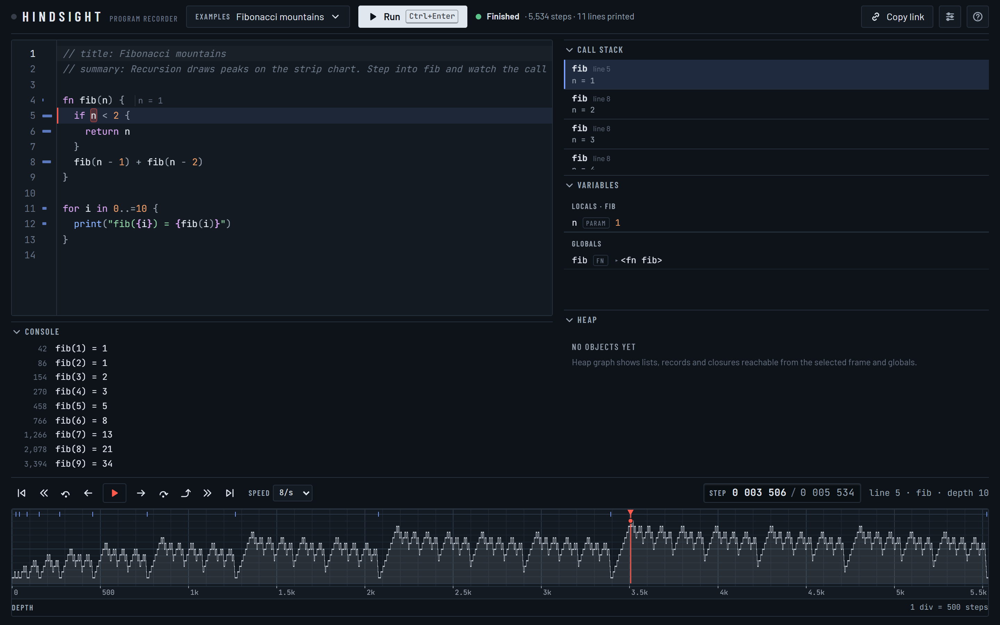
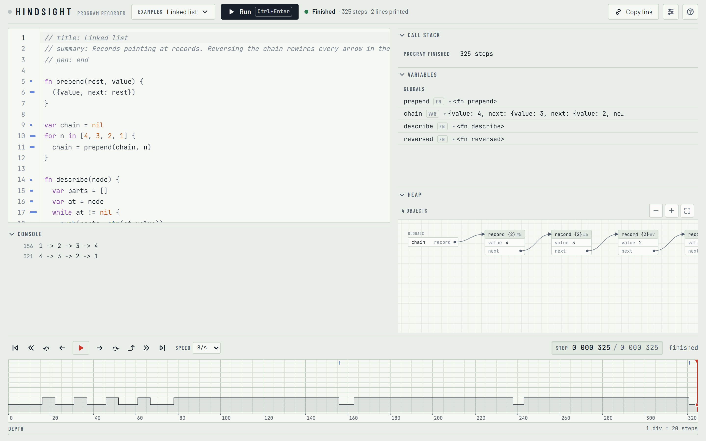
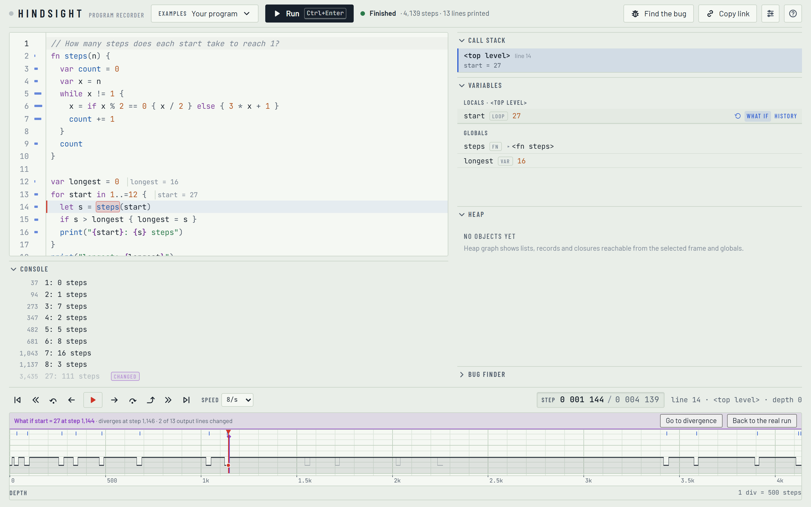
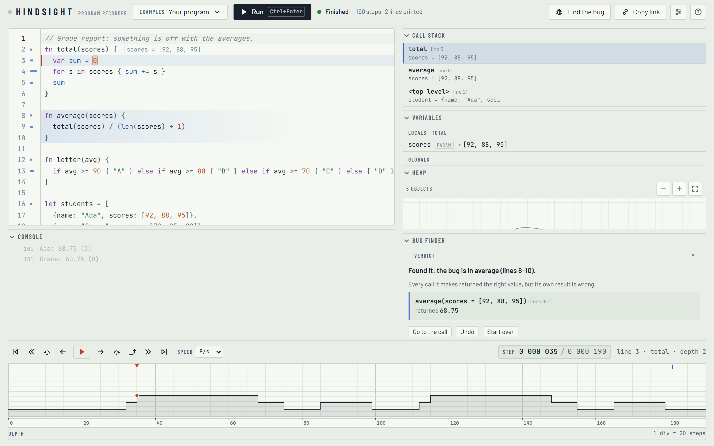

# Hindsight

[](https://github.com/Ajaypranav25/Hindsight/actions/workflows/ci.yml)

**A tiny programming language with a time machine built in.**

Run a program, then drag a red pen backwards through its execution. Step into, over and out of
calls in _both_ directions, ask any variable where its value came from, click a line of output to
land on the moment it was printed, and watch the heap rewire itself as you scrub.

Then change the past: give any variable another value at any moment and Hindsight forks the run
there, so you see where the new future diverges from the real one. Or let it find the bug: answer
a few yes/no questions about the calls your program made, and it names the function whose own code
is wrong.



Hindsight is a language and a debugger designed together. Every program runs on a bytecode VM that
records its own execution, so the studio can rebuild the complete program state at any step — the
call stack, every variable, every list and record — in under a millisecond.

## Try it

**In your browser:** [ajaypranav25.github.io/Hindsight](https://ajaypranav25.github.io/Hindsight/),
nothing to install. Or run it locally:

```sh
npm install
npm run dev          # opens Hindsight Studio at http://localhost:5173
```

The studio opens with a gallery program already recorded. Pick another from **Examples**: a bug hunt
where the answer is one click away, a crash you can rewind out of, recursion that draws mountain
ranges, closures, a breadth-first maze search, the Game of Life, a bug to find by answering
questions, a what-if to fork, and more.

## A taste of the language

```
fn fib(n) {
  if n < 2 { n } else { fib(n - 1) + fib(n - 2) }
}

let orders = [
  {customer: "ada", amount: 30, paid: true},
  {customer: "grace", amount: 12, paid: false},
  {customer: "ada", amount: 55, paid: true},
]

let revenue = orders
  |> filter(|o| o.paid)
  |> map(|o| o.amount)
  |> sum()

match [fib(10), revenue] {
  [55, total] if total > 80 => print("all good: {total}")
  [f, _] => print("unexpected fib: {f}")
}
```

Dynamically typed and expression-oriented: blocks, `if` and `match` produce values; `let` bindings
are immutable and `var` ones are not; functions are closures; lists, records and ranges are built in;
pattern matching destructures lists and records with guards and alternatives; `|>` pipes values
through calls; strings interpolate `{expressions}`. Error messages are specific and come with hints
(`undefined variable 'lenght'` → `did you mean 'length'?`). The full reference is
[docs/SPEC.md](docs/SPEC.md).

## The studio

|                                 |                                                                                                                                                                                                                                           |
| ------------------------------- | ----------------------------------------------------------------------------------------------------------------------------------------------------------------------------------------------------------------------------------------- |
| **Strip chart**                 | The whole run is traced like a chart recorder: x is time, height is call depth. Drag the pen anywhere; zoom and pan with the wheel. Output, breakpoint hits and watched writes appear as markers.                                         |
| **Two-way stepping**            | Step into, over and out, forwards and backwards. Continue to a breakpoint, or back to the previous one. Step over is based on the actual call, not just the depth, so `sq(2) + sq(3)` behaves.                                            |
| **⟲ Where did this come from?** | Every variable, list element and record field has an origin button. It jumps to the step that produced the value and marks the line that set it.                                                                                          |
| **History**                     | Every change to a binding, as a list and a sparkline, plotted on the strip chart. Loop variables keep one history across iterations.                                                                                                      |
| **Time-aware console**          | Output printed after the pen is ghosted. Click any line to land on the moment it was printed.                                                                                                                                             |
| **Heat gutter**                 | How often each line ran, on a log scale. Click to jump to the next time it runs.                                                                                                                                                          |
| **Heap graph**                  | Lists, records and closures reachable from the selected frame, with stable positions as you scrub, so a reversed linked list visibly rewires its arrows.                                                                                  |
| **Just my code**                | Library functions (`map`, `filter`, `sort_by`, …) are written in Hindsight and recorded too; just-my-code skips them unless you want to look inside.                                                                                      |
| **What if?**                    | Change any variable, list element or record field at the pen: the run forks there, the strip chart shows where the new future diverges (with the real run as a ghost behind it), and changed output is marked. Fork again to stack edits. |
| **Bug finder**                  | Answer right / wrong / not sure about recorded calls (`average(xs = [88, 83, 79])` returned `54`) until Hindsight names the function whose own code is wrong. Identical calls are asked about only once.                                  |
| **Moment links**                | Copy a link that carries the program and the pen's step: it opens on the very moment you were looking at, so a bug report lands on the bug.                                                                                               |







Keyboard: **F11** / **Shift+F11** step into forward/back, **F10** / **Shift+F10** step over,
**F7** / **Shift+F7** step out, **F8** / **Shift+F8** continue, **F9** breakpoint, **Space** play,
**Home** / **End** jump to the ends, **Ctrl+Enter** run.

## The command line

Run it through npm as below, or build it once with `npm run build:cli && npm link` to get a
`hindsight` command.

```sh
npm run sight -- run examples/03-fibonacci.sight
npm run sight -- replay examples/03-fibonacci.sight --at 3500     # the program state at step 3,500
npm run sight -- why examples/02-bug-hunt.sight --line 8 --name total   # every change to 'total'
npm run sight -- disasm examples/01-hello.sight
npm run sight -- test                                            # the conformance corpus
npm run sight -- repl
npm run sight -- whatif examples/18-what-if.sight --at 1144 --set start=27   # fork the run
npm run sight -- debug examples/17-find-the-bug.sight                       # find the bug
```

`whatif` forks the recorded run and compares the two futures:

```
what if start = 27 at step 1,144 (it was 9)
the futures diverge at step 1,146 · line 16, column 11 · in <top level>
real run: 2,264 steps, finishes normally
what if:  4,139 steps, finishes normally
output: 2 lines only in the real run (-), 2 only in the what-if (+)
 … 5 unchanged lines
 8: 3 steps
-9: 19 steps
+27: 111 steps
 10: 6 steps
 …
-longest: 19
+longest: 111
```

`debug` interviews you about the calls the program made, then points at the culprit:

```
Question 1: average(scores = [92, 88, 95]) returned 68.75
Is that right? [r/w/n/u/q] w
Question 2: total(scores = [92, 88, 95]) returned 275
Is that right? [r/w/n/u/q] r
Found it: the bug is in average (lines 10–12).
Every call it makes returned the right value, but its own result is wrong.

  10 | fn average(scores) {
  11 |   total(scores) / (len(scores) + 1)
  12 | }
```

`why` answers the question a debugger usually makes you hunt for:

```
history of 'total' (declared on line 8, average):
  step 14        declare  total = 0    line 8
  step 28        write    total = 92   line 10    <- the first score, 88, was never added
  step 38        write    total = 171  line 10
  ...
```

## How it works

```
source ─▶ lexer ─▶ parser ─▶ compiler ─▶ bytecode + debug info
                                              │
                    recorder ◀── VM (stack machine, explicit frames, no host recursion)
                       │
     trace (typed arrays) + snapshots + event log ─▶ seek · navigate · explain · inspect
```

- **Recording.** The VM's entire state is plain data, so the recorder stores a compact per-step trace
  (location and depth in typed arrays), an event log of every declaration, write, allocation and
  list mutation, and periodic deep snapshots. Snapshot spacing grows with snapshot size, so memory
  stays bounded even for heap-heavy programs.
- **Seeking.** To show step `t`, restore the nearest snapshot at or before `t` and replay forward;
  the run is deterministic (even `random()` is a seeded generator inside the VM state), so replay
  reproduces it exactly. A 1.26-million-step run records in about 0.2 s and seeks in about 0.35 ms.
- **Navigation** works on the trace alone: stepping backwards is a scan over typed arrays, not
  re-execution.
- **Provenance** queries the event log, translating list indexes back through every insert, remove
  and pop, so "where did `xs[2]` come from?" still has the right answer after the list was
  reshuffled.
- **What-if forks** copy the run's past up to the chosen step, write the edit into a fresh VM there,
  pin a snapshot of the edited state as a seek barrier (so no replay can slip back into the real
  run's future), and record a new future. Comparing the two finds where they first behave
  differently and diffs their output.
- **The bug finder** is algorithmic debugging (Shapiro, 1982) over the recorded call tree: arguments
  come from each call's first step and results from the caller's operand stack just after the
  return, so nothing extra is recorded. Answers are remembered per call, so recursion costs one
  question per distinct call.

Details: [docs/ARCHITECTURE.md](docs/ARCHITECTURE.md).

## Quality

- **About 2,500 automated tests** across unit, property, conformance and end-to-end suites.
- **A conformance corpus of 500+ programs** (`tests/lang`), most written from the spec alone before
  the implementation existed, with expected output, compile errors and runtime errors annotated
  inline.
  Run it with `npm run sight -- test`.
- **Property tests** (fast-check) check that every seek reproduces the state of a fresh run, that
  navigation and provenance respect time, and that snapshots round-trip exactly.
- **Fuzzing** keeps the lexer and parser from throwing on arbitrary input, and a bytecode verifier
  checks the stack discipline of every corpus program, gallery example and generated program.
- **Playwright** end-to-end tests drive the studio in Chrome.
- **CI** runs all of it on Linux and Windows, plus the performance budgets, and publishes the
  studio to GitHub Pages from `main`.
- About 96 % line coverage, enforced so it cannot drift down; strict TypeScript; zero runtime
  dependencies in the language core.

```sh
npm test            # unit, property and conformance tests
npm run test:perf   # wall-clock budgets, one file at a time (kept out of npm test)
npm run e2e         # end-to-end tests (uses your installed Chrome)
npm run check       # type-check, lint, format check and test
```

## Project layout

```
src/core/          the language: lexer, parser, compiler, VM, recorder, navigator, provenance, inspector
src/studio/        the React + CodeMirror studio
src/cli/           the hindsight command-line tool
src/conformance/   the annotation checker shared by the test suite and `hindsight test`
tests/lang/        the conformance corpus
examples/          the studio's gallery programs
docs/              language specification and architecture
```

## License

MIT
