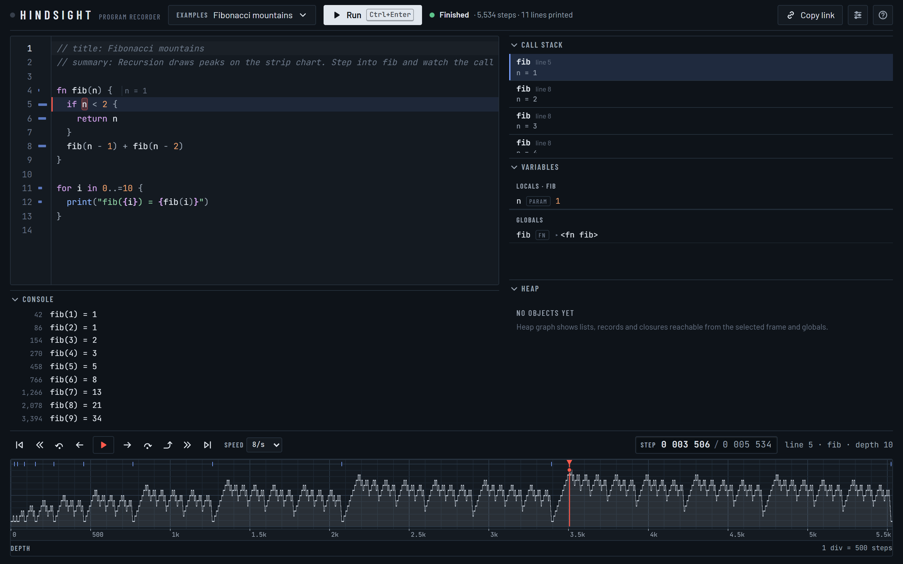
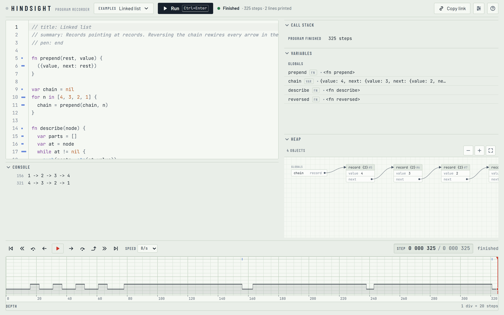

# Hindsight

**A tiny programming language with a time machine built in.**

Run a program, then drag a red pen backwards through its execution. Step into, over and out of
calls in _both_ directions, ask any variable where its value came from, click a line of output to
land on the moment it was printed, and watch the heap rewire itself as you scrub.



Hindsight is a language and a debugger designed together. Every program runs on a bytecode VM that
records its own execution, so the studio can rebuild the complete program state at any step — the
call stack, every variable, every list and record — in under a millisecond.

## Try it

```sh
npm install
npm run dev          # opens Hindsight Studio at http://localhost:5173
```

The studio opens with a gallery program already recorded. Pick another from **Examples**: a bug hunt
where the answer is one click away, a crash you can rewind out of, recursion that draws mountain
ranges, closures, a breadth-first maze search, the Game of Life and more.

## A taste of the language

```
fn fib(n) {
  if n < 2 { n } else { fib(n - 1) + fib(n - 2) }
}

let orders = [
  {customer: "ada", amount: 30, paid: true},
  {customer: "grace", amount: 12, paid: false},
  {customer: "ada", amount: 55, paid: true},
]

let revenue = orders
  |> filter(|o| o.paid)
  |> map(|o| o.amount)
  |> sum()

match [fib(10), revenue] {
  [55, total] if total > 80 => print("all good: {total}")
  [f, _] => print("unexpected fib: {f}")
}
```

Dynamically typed and expression-oriented: blocks, `if` and `match` produce values; `let` bindings
are immutable and `var` ones are not; functions are closures; lists, records and ranges are built in;
pattern matching destructures lists and records with guards and alternatives; `|>` pipes values
through calls; strings interpolate `{expressions}`. Error messages are specific and come with hints
(`undefined variable 'lenght'` → `did you mean 'length'?`). The full reference is
[docs/SPEC.md](docs/SPEC.md).

## The studio

|                                 |                                                                                                                                                                                                   |
| ------------------------------- | ------------------------------------------------------------------------------------------------------------------------------------------------------------------------------------------------- |
| **Strip chart**                 | The whole run is traced like a chart recorder: x is time, height is call depth. Drag the pen anywhere; zoom and pan with the wheel. Output, breakpoint hits and watched writes appear as markers. |
| **Two-way stepping**            | Step into, over and out, forwards and backwards. Continue to a breakpoint, or back to the previous one. Step over is based on the actual call, not just the depth, so `sq(2) + sq(3)` behaves.    |
| **⟲ Where did this come from?** | Every variable, list element and record field has an origin button. It jumps to the step that produced the value and marks the line that set it.                                                  |
| **History**                     | Every change to a binding, as a list and a sparkline, plotted on the strip chart. Loop variables keep one history across iterations.                                                              |
| **Time-aware console**          | Output printed after the pen is ghosted. Click any line to land on the moment it was printed.                                                                                                     |
| **Heat gutter**                 | How often each line ran, on a log scale. Click to jump to the next time it runs.                                                                                                                  |
| **Heap graph**                  | Lists, records and closures reachable from the selected frame, with stable positions as you scrub, so a reversed linked list visibly rewires its arrows.                                          |
| **Just my code**                | Library functions (`map`, `filter`, `sort_by`, …) are written in Hindsight and recorded too; just-my-code skips them unless you want to look inside.                                              |
| **Share**                       | Copy a link that carries the program in the URL.                                                                                                                                                  |



Keyboard: **F11** / **Shift+F11** step into forward/back, **F10** / **Shift+F10** step over,
**F7** / **Shift+F7** step out, **F8** / **Shift+F8** continue, **F9** breakpoint, **Space** play,
**Home** / **End** jump to the ends, **Ctrl+Enter** run.

## The command line

```sh
npm run sight -- run examples/03-fibonacci.sight
npm run sight -- replay examples/03-fibonacci.sight --at 3500     # the program state at step 3,500
npm run sight -- why examples/02-bug-hunt.sight --line 8 --name total   # every change to 'total'
npm run sight -- disasm examples/01-hello.sight
npm run sight -- test                                            # the conformance corpus
npm run sight -- repl
```

`why` answers the question a debugger usually makes you hunt for:

```
history of 'total' (declared on line 8, average):
  step 14        declare  total = 0    line 8
  step 28        write    total = 92   line 10    <- the first score, 88, was never added
  step 38        write    total = 171  line 10
  ...
```

## How it works

```
source ─▶ lexer ─▶ parser ─▶ compiler ─▶ bytecode + debug info
                                              │
                    recorder ◀── VM (stack machine, explicit frames, no host recursion)
                       │
     trace (typed arrays) + snapshots + event log ─▶ seek · navigate · explain · inspect
```

- **Recording.** The VM's entire state is plain data, so the recorder stores a compact per-step trace
  (location and depth in typed arrays), an event log of every declaration, write, allocation and
  list mutation, and periodic deep snapshots. Snapshot spacing grows with snapshot size, so memory
  stays bounded even for heap-heavy programs.
- **Seeking.** To show step `t`, restore the nearest snapshot at or before `t` and replay forward;
  the run is deterministic (even `random()` is a seeded generator inside the VM state), so replay
  reproduces it exactly. A 1.26-million-step run records in about 0.2 s and seeks in about 0.35 ms.
- **Navigation** works on the trace alone: stepping backwards is a scan over typed arrays, not
  re-execution.
- **Provenance** queries the event log, translating list indexes back through every insert, remove
  and pop, so "where did `xs[2]` come from?" still has the right answer after the list was
  reshuffled.

Details: [docs/ARCHITECTURE.md](docs/ARCHITECTURE.md).

## Quality

- **About 2,500 automated tests** across unit, property, conformance and end-to-end suites.
- **A 501-program conformance corpus** (`tests/lang`) written from the spec alone, before the
  implementation existed, with expected output, compile errors and runtime errors annotated inline.
  Run it with `npm run sight -- test`.
- **Property tests** (fast-check) check that every seek reproduces the state of a fresh run, that
  navigation and provenance respect time, and that snapshots round-trip exactly.
- **Fuzzing** keeps the lexer and parser from throwing on arbitrary input, and a bytecode verifier
  checks the stack discipline of every compiled program.
- **Playwright** end-to-end tests drive the studio in Chrome.
- 98 % line coverage; strict TypeScript; zero runtime dependencies in the language core.

```sh
npm test            # unit, property and conformance tests
npm run e2e         # end-to-end tests (uses your installed Chrome)
npm run check       # type-check, lint and test
```

## Project layout

```
src/core/          the language: lexer, parser, compiler, VM, recorder, navigator, provenance, inspector
src/studio/        the React + CodeMirror studio
src/cli/           the hindsight command-line tool
src/conformance/   the annotation checker shared by the test suite and `hindsight test`
tests/lang/        the conformance corpus
examples/          the studio's gallery programs
docs/              language specification and architecture
```

## License

MIT
